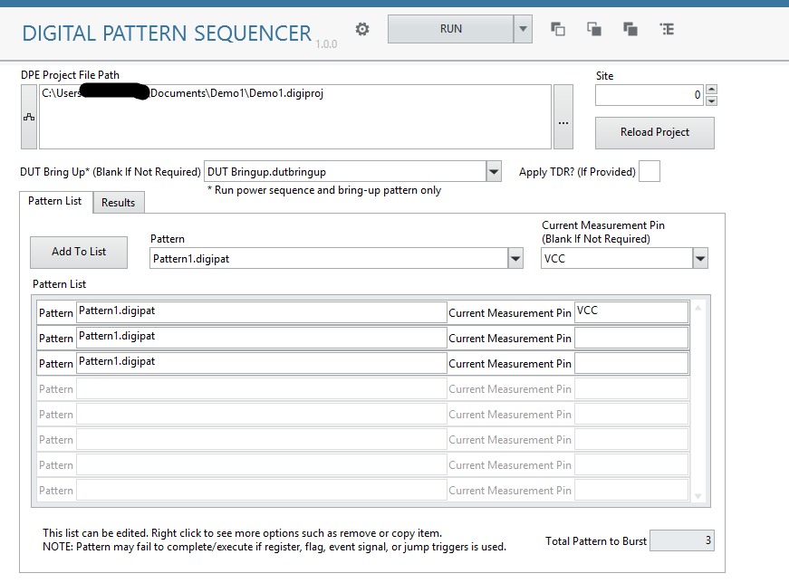
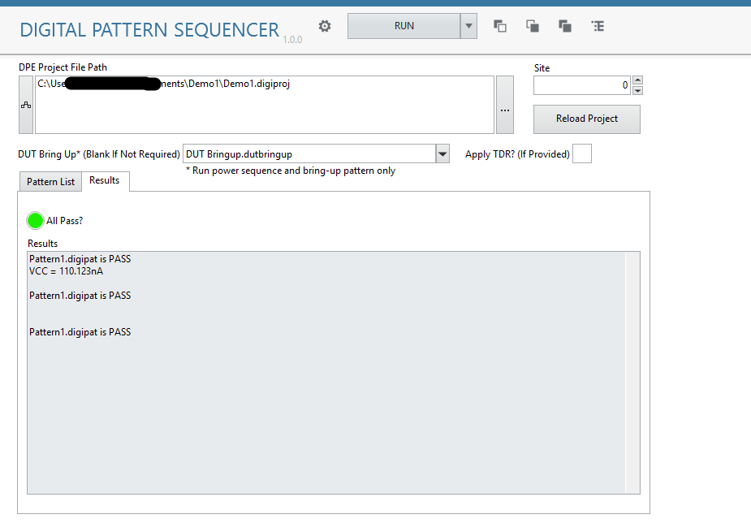

# NI Digital Pattern Sequencer - IS Measurement Plugin
## Overview
An InstrumentStudio measurement plugin that bursts a list of digital patterns and check its pass/fail results.
Optionally, it perform current measurement on a pin after each pattern burst. 

**Result View**

## Execution Flow

1. Apply TDR 
2. Run DUT Bring-Up Power Sequence
3. Burst DUT Bring-Up Pattern
4. Iterate every row in the **Pattern List**: Burst the pattern first and then perform current measurement

## Limitation

- For DCPower and PPMU source and measure settings, the value cannot be computed by formula or from variables in `specifications` sheet. It must be the exact value because NI Digital Pattern library does not provide function to get computed value from 'digilevel' sheet and 'dutbringup' sheet.
- Specify pin name by pin group in current measurement after each pattern burst is not supported. 
- Specify pin name by pin group in power sequence of DUT Bring Up sheet is not supported. 
